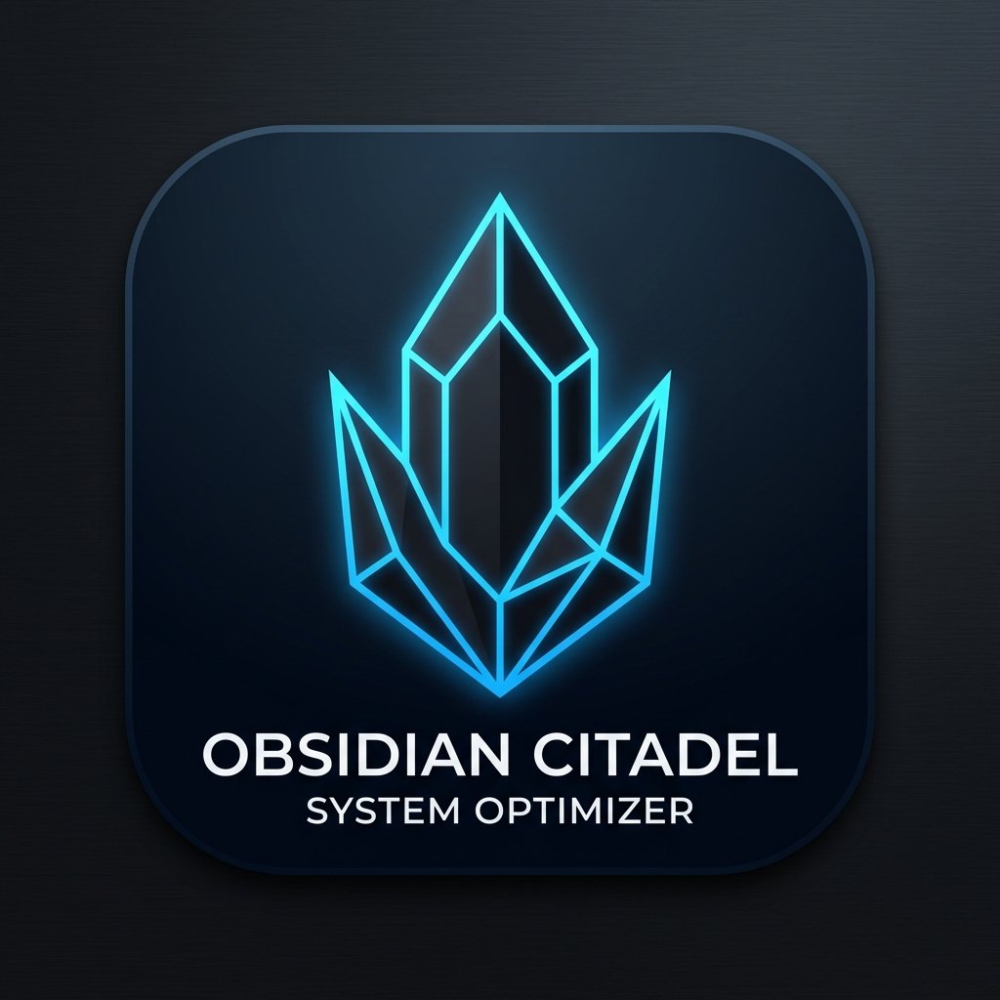

<p align="center">
  
</p>

<h1 align="center">Obsidian Citadel</h1>

<p align="center">
  Switch a Linux workstation between work modes in one click.
</p>

---

One Linux machine often does several jobs: gaming, web development, running local AI models, a security lab. Each job wants different things running and different kernel settings. Obsidian Citadel stores each job as a **profile**: which systemd services and background processes should run, and how the CPU, GPU, memory and audio should be tuned. Applying a profile makes the machine match it, and keeps it that way.

It is built for, and used daily on, my own workstation. The default service list, process list and Docker Compose paths in [`switcher/config.py`](switcher/config.py) describe that machine. Edit them, or the profiles in `~/obsidian-citadel.toml`, to match yours.

## How it works

```
 GTK dashboard ─┐
 tray icon ─────┼── gRPC (port 50051) ──▶ citadel-hub (root, systemd)
 citadel_cli ───┘                            │
                                             ├─ reconciler: compares live state with the profile every 10 s
                                             └─ builds a bash script and runs it as root
```

- **Hub** ([`services/hub/`](services/hub/)): a root daemon run by systemd ([`citadel-hub.service`](internal/systemd/citadel-hub.service)). It serves `SetProfile`, `GetCurrentState` and `StreamTelemetry` ([`citadel.proto`](internal/protocol/citadel.proto)).
- **Reconciler** ([`reconciler.py`](services/hub/reconciler.py)): every 10 seconds it checks services, processes, swappiness and frozen state against the active profile. If anything has drifted, it re-applies the profile, so a service you stop by hand comes back.
- **Dashboard** ([`switcher/ui/`](switcher/ui/)): an unprivileged GTK 3 app. It edits profiles, toggles services and processes, and shows live CPU, GPU, RAM and network usage streamed from the hub.
- **Tray icon** ([`citadel_tray.py`](citadel_tray.py)) and **CLI** ([`citadel_cli.py`](citadel_cli.py)): quick switching without opening the dashboard.

## Profiles

Five profiles are built in. Every one can be edited, and you can add your own.

| Profile | Runs | Tuning |
|---|---|---|
| **Gaming** | Only what a game needs: Docker, databases and web servers are stopped | `performance` CPU governor, CPU cores reserved for the game, swappiness 10, THP off, AMD GPU forced to its high performance level, higher PipeWire priority |
| **Programming** | Docker, PostgreSQL, MySQL, Nginx, PHP-FPM, Samba, Cloudflare Tunnel | Balanced defaults |
| **AI + Dev** | The Programming stack plus Ollama, a Qdrant vector database and a local AI assistant stack | THP `madvise` |
| **Red Team** | Fail2Ban, Snort, Tor and an OWASP Juice Shop lab | Stealth: all TCP and DNS routed through Tor, SSH port closed, Wi-Fi MAC randomized, Bluetooth blocked, page caches dropped and swap cycled on apply |
| **Game Dev** | MySQL, Nginx and Samba for sharing builds | Light background load |

## What a profile controls

- **Services:** start, stop or freeze (`systemctl freeze`) any systemd unit.
- **Processes:** start, kill, or freeze in a cgroup v2 freezer (`/sys/fs/cgroup/citadel_cryo_*`). A frozen process keeps its memory but gets no CPU, and thaws instantly when you switch back.
- **CPU:** scaling governor and energy-performance preference, plus reserving the last two cores for the game while system tasks are kept off them.
- **Memory:** swappiness, transparent huge pages, `vm.dirty_ratio` and `vm.dirty_background_ratio`.
- **GPU:** the vendor is detected automatically for live telemetry: `nvidia-smi` on NVIDIA, [LACT](https://github.com/ilya-zlobintsev/LACT) on AMD. On AMD, a profile can force the DPM performance level to `high`. A GPU power limit and NVIDIA performance mode can be saved in a profile, but switching doesn't apply them yet.
- **Audio:** raises PipeWire and WirePlumber scheduling priority for lower latency while gaming.
- **Network:** transparent Tor routing, SSH lockout, MAC randomization and Bluetooth blocking (Red Team).

### Applied on every switch

Some maintenance steps run on every profile change, whatever the profile:

- `fstrim -av`, dropping page caches, and resizing `/dev/shm` to 4 GB
- `docker image prune -f` (removes dangling images)
- `aa-enforce /etc/apparmor.d/*` (puts every AppArmor profile in enforce mode)
- on ZFS systems with a pool named `rpool`: a recursive snapshot and a scrub

The hooks are grouped by area in [`switcher/plugins/`](switcher/plugins/). About half of them change the system today. The rest only log a line until they're implemented. [`TODO.MD`](TODO.MD) is the roadmap for them.

## Requirements

- Linux with systemd and cgroups v2
- Python 3.11 or later, PyGObject with GTK 3, and Ayatana AppIndicator for the tray icon
- The packages in [`requirements.txt`](requirements.txt): `psutil`, `grpcio`, `protobuf`
- Optional: `nvidia-smi` or `lact` for GPU control, NetworkManager for MAC randomization, Tor for the Red Team profile

## Installing

```bash
git clone https://github.com/jakes1345/system-mode-switcher.git
cd system-mode-switcher
sudo ./install.sh
```

`install.sh` detects `apt`, `pacman`, `dnf` or `zypper` and installs the dependencies. It then copies the app to `/opt/obsidian-citadel`, installs the desktop entry, icons and PolicyKit policy, and enables `citadel-hub.service`. Launch **Obsidian Citadel** from your app menu.

`ExecStart` in [`internal/systemd/citadel-hub.service`](internal/systemd/citadel-hub.service) points at the development checkout. On another machine, change it to `/opt/obsidian-citadel/services/hub/main.py` before running the installer.

For Debian and Ubuntu, `./build_deb.sh` builds a `.deb` package instead.

### Running from source

```bash
pip install -r requirements.txt
sudo python3 services/hub/main.py     # the hub, in one terminal
python3 main.py                       # the dashboard, in another
```

## Command line

```bash
python3 citadel_cli.py status         # active profile and system state
python3 citadel_cli.py set Gaming     # switch profile
python3 citadel_cli.py monitor        # live telemetry
```

## Security

- **The hub runs as root and listens on port 50051 on all interfaces, with no authentication.** Any machine that can reach that port can switch your profile. Block the port in your firewall, or change `add_insecure_port('[::]:50051')` in [`services/hub/main.py`](services/hub/main.py) to `127.0.0.1:50051`.
- **The PolicyKit policy lets any user in the active session run `/usr/local/bin/citadel-apply` as root without a password**, and `citadel-apply` runs whatever script it is given. Only install it on a machine where you are the only user. For a shared machine, change `allow_active` in [`com.obsidian.citadel.policy`](internal/security/com.obsidian.citadel.policy) to `auth_admin_keep`.

## Tests

```bash
python3 -m unittest discover tests
```
